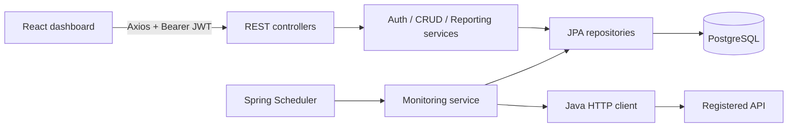
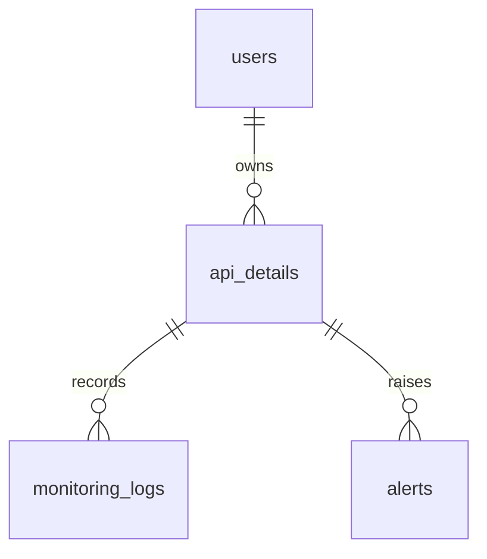
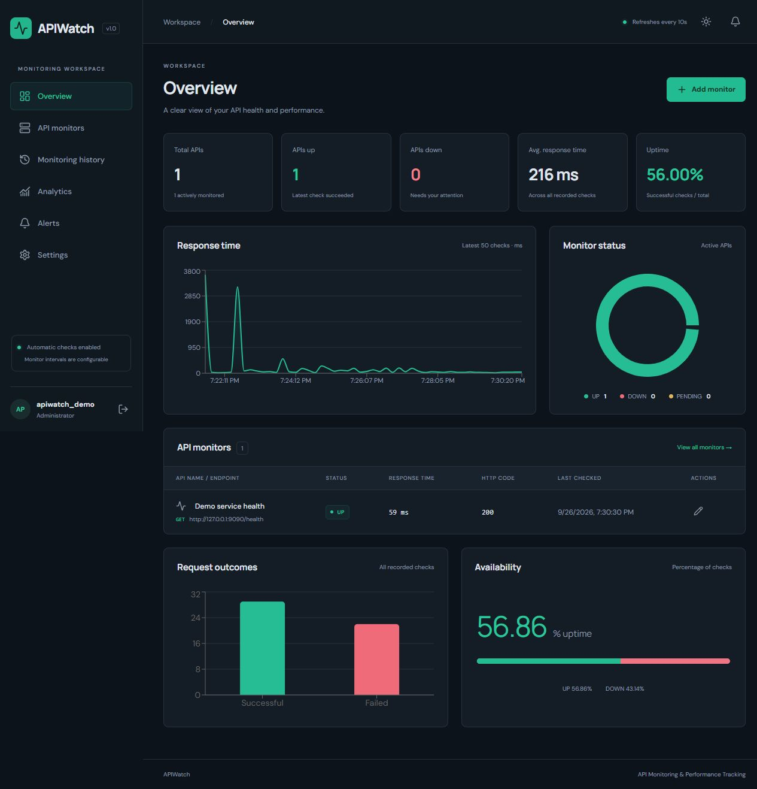
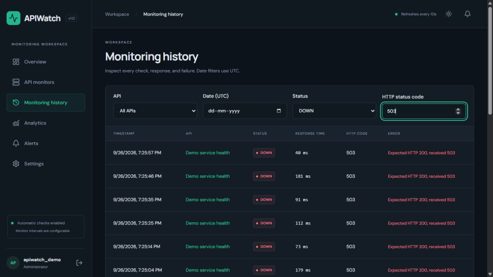
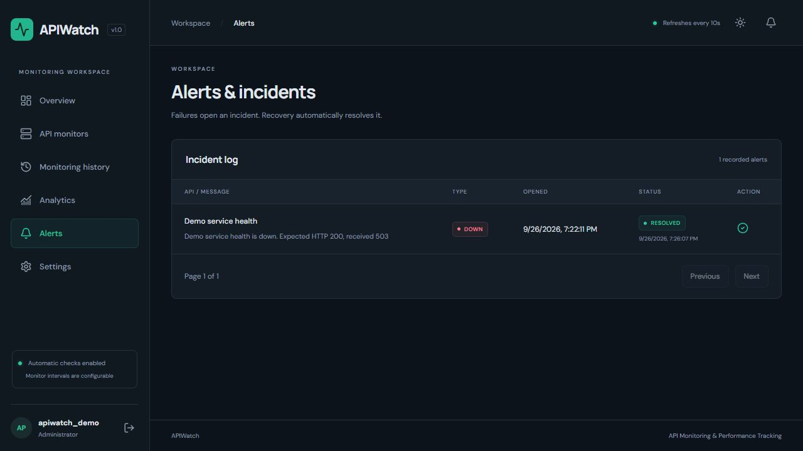

# APIWatch — API Monitoring & Performance Tracking

A working college project that monitors real HTTP endpoints, stores results in PostgreSQL, and presents live availability and performance metrics. Built for a third-year B.Tech CSE demonstration.

## Features

- Admin registration/login, BCrypt passwords, signed two-hour JWTs, protected routes, and account-specific data.
- API CRUD, pause/resume, intervals (10–86,400 seconds), timeouts (1–30 seconds), and expected status codes.
- Real scheduled HTTP checks, latency, status codes, persistent history, filters, and pagination.
- Alerts on first failure and UP → DOWN transitions; automatic recovery resolution and manual resolution.
- Dashboard, four chart types, per-API analytics, profile, dark/light themes, responsive layout.
- Docker Compose for PostgreSQL, Spring Boot, and React/Nginx.

## Stack

Java 21, Spring Boot 3.5, Spring Web, Data JPA, Security, OAuth2 Resource Server (JWT), Validation, Maven, PostgreSQL. Frontend: React 19, Vite 7, JavaScript, Axios, React Router, Recharts, Lucide icons, and CSS. Tests: JUnit 5, Mockito, MockMvc, H2, Vitest, React Testing Library.

## Quick start: Docker

1. Start Docker Desktop.
2. Copy `.env.example` to `.env`.
3. Replace `DB_PASSWORD` and `JWT_SECRET` with random values. The JWT secret must contain at least 32 bytes. Generate one with `node -e "console.log(require('crypto').randomBytes(48).toString('base64'))"`.
4. Run `docker compose up --build` from this folder.
5. Open **http://localhost:3000**, create an account, and add your first monitor.

Example endpoint: `https://example.com`, GET, expected 200, interval 60 seconds, timeout 10 seconds. Checks start automatically. There are no preset accounts or fabricated monitoring results.

`docker compose down` stops services and preserves database data. PostgreSQL uses a named volume and is not exposed on a host port. Frontend/backend ports bind to localhost. Allow the backend to finish starting before signing in.

## Local installation

Prerequisites: Java 21 JDK, Maven 3.9+, Node.js 22.12+, PostgreSQL 13+ (17 recommended).

### PostgreSQL setup

In psql or pgAdmin as a PostgreSQL administrator, substitute a password of your own:

```sql
CREATE ROLE apiwatch LOGIN PASSWORD 'YOUR_RANDOM_PASSWORD';
CREATE DATABASE apiwatch OWNER apiwatch;
```

JPA creates tables/indexes using `ddl-auto=update`. Use versioned migrations before a production deployment.

### Backend

From this project's root, in PowerShell:

```powershell
$env:DB_URL = 'jdbc:postgresql://localhost:5432/apiwatch'
$env:DB_USER = 'apiwatch'
$env:DB_PASSWORD = 'YOUR_RANDOM_PASSWORD'
$env:JWT_SECRET = 'YOUR_RANDOM_SECRET_AT_LEAST_32_BYTES'
$env:FRONTEND_ORIGIN = 'http://localhost:5173'
cd backend
mvn spring-boot:run
```

On macOS/Linux, use `export NAME='value'` instead of `$env:NAME = 'value'`. Backend runs at **http://localhost:8080**. `GET /api/health` is public.

Maven/Spring do not automatically read the root `.env`; export its values as above. Docker Compose reads `.env` automatically.

On Windows, after configuring `.env`, you can also run `./scripts/start-backend.ps1` and `./scripts/start-frontend.ps1` in separate PowerShell terminals.

### Frontend

In a second terminal:

```sh
cd frontend
npm ci
npm run dev
```

Open **http://localhost:5173**. Vite proxies `/api` to port 8080. A separate deployment can set `VITE_API_URL` at build time; set backend `FRONTEND_ORIGIN` to the exact frontend origin.

## Architecture



Controllers validate DTOs and delegate. Services contain business logic and ownership checks. Repositories handle persistence. The scheduler selects up to 50 due APIs every second and uses eight worker threads. A row lock prevents overlapping checks and protects against simultaneous edits/deletion. Each check's log, alert transition, and next scheduled time commit together.

This deliberately targets a **single backend instance** for a college demo. A slow batch can delay checks. Intervals are minimum delays after completion, not exact wall-clock schedules. HTTP work holds a database transaction; a larger deployment should separate workers and transaction boundaries.

### Monitoring semantics

- Actual status equals expected status → UP; otherwise DOWN.
- Timeout, DNS error, connection failure, or blocked destination → DOWN with an error and no HTTP status.
- Latency uses a monotonic timer and includes destination validation and HTTP work. Response bodies are discarded; redirects are not followed.
- A new API is PENDING. Paused APIs retain their last result but are excluded from active UP/DOWN counts.
- Uptime = successful checks / total checks × 100. It is **sample-based**, not elapsed-time uptime. With no checks, uptime is unknown.
- Average/min/max include failed checks. Charts show the latest 60 checks; totals include all retained history.
- Database timestamps are UTC. UI timestamps use local time; date filters use UTC.
- Deletion removes the monitor, its logs, and its alerts after confirmation.

## Database design



| Table | Main fields |
|---|---|
| users | id, username (unique), email (unique), password hash, role, created_at |
| api_details | id, owner_id, name, url, http_method, description, expected_status_code, monitoring_interval, timeout, active, created_at, updated_at, next_check_at, last_status, last_status_code, last_response_time, last_checked |
| monitoring_logs | id, api_id, api_name, url, http_method, status, status_code, response_time, error_message, checked_at |
| alerts | id, api_id, api_name, alert_type, message, resolved, created_at, resolved_at |

Foreign keys prevent orphans. Indexes cover owner lookups, API/time history, and unresolved alerts. Logs preserve endpoint/name/method snapshots when API configuration changes.

## REST endpoints

Except register, login, and health, all routes require `Authorization: Bearer <token>`. Each admin can access only their own records.

| Method | Route | Purpose |
|---|---|---|
| POST | `/api/auth/register` | Register and receive JWT/profile |
| POST | `/api/auth/login` | Login and receive JWT/profile |
| GET | `/api/auth/me` | Current account |
| GET | `/api/health` | Process health |
| GET / POST | `/api/apis` | List / create monitors |
| GET / PUT / DELETE | `/api/apis/{id}` | Read / update / delete |
| GET | `/api/monitoring` | Filtered paginated history |
| GET | `/api/monitoring/{apiId}` | Per-API history |
| GET | `/api/analytics` | Overall analytics |
| GET | `/api/analytics/{apiId}` | Per-API analytics |
| GET | `/api/alerts?page=0` | Paginated alerts |
| GET | `/api/alerts/unresolved-count` | Count all unresolved incidents |
| PUT | `/api/alerts/{id}/resolve` | Resolve alert |

History parameters: `api`, `date=YYYY-MM-DD`, `status=UP|DOWN`, `statusCode`, zero-based `page`, and `size` (1–100, default 20).

Registration:

```json
{"username":"student","email":"student@example.com","password":"choose-a-unique-password"}
```

Create/update API:

```json
{"name":"Catalog health","url":"https://example.com","httpMethod":"GET","description":"Demo check","expectedStatusCode":200,"monitoringInterval":60,"timeout":10,"active":true}
```

Pause/resume uses PUT with `active` changed. Errors return a meaningful `message` and status: 400 validation, 401 authentication, 404 inaccessible/missing records, 409 duplicates, 500 unexpected errors. Controller errors include `timestamp`. Creation returns 201; deletion returns 204.

## Folder structure

```text
backend/src/main/java/com/apiwatch/
  config/       Security and CORS
  controller/   REST endpoints
  dto/          Validated requests
  entity/       JPA entities
  exception/    JSON errors
  repository/   Database queries
  scheduler/    Scheduled work
  service/      Business logic and HTTP probes
backend/src/test/  JUnit/Mockito/integration tests
frontend/src/
  components/   Reusable cards, badges, dialogs, charts, loading/errors
  context/      Authentication state
  hooks/        Polling data hook
  pages/        Route screens
  services/     Axios client
  utils/        Display formatting
scripts/        Controllable demo endpoint
docs/           Demo and verification notes
docker-compose.yml
.env.example
```

## Tests and builds

```sh
cd backend
mvn test
mvn package
cd ../frontend
npm ci
npm test
npm run build
```

Tests cover auth, BCrypt, invalid tokens, CRUD, ownership, validation, actual HTTP checks, timeouts, connection failures, due-time gating, alerts, analytics, filters, pagination, and dependent deletion. Default backend tests use H2 in PostgreSQL compatibility mode and a real local HTTP server. See [verification notes](docs/VERIFICATION.md) for checks actually completed.

For PostgreSQL integration testing, pass `-Dspring.datasource.url=jdbc:postgresql://localhost:5432/apiwatch_test -Dspring.datasource.username=... -Dspring.datasource.password=...` to Maven. **Use a disposable test database**: tests clear data and use create-drop schema mode.

## Security and scope

- Password hashes are excluded from JSON. Secrets come from environment variables.
- JWTs expire after two hours. Logout removes the tab's session token; server-side revocation and refresh tokens are not implemented.
- Only HTTP/HTTPS URLs without embedded credentials/fragments are allowed. Private destinations are screened and redirects disabled.
- `ALLOW_PRIVATE_TARGETS=true` enables trusted local demo endpoints. Keep false otherwise. DNS screening is a basic safeguard, not a complete SSRF boundary; add network egress rules and destination allowlists for untrusted users because DNS rebinding remains possible.
- Registration is open for the demo. Rate limiting, email verification, and password reset are future work. Accounts are administrators of their own workspace.
- GET is fully supported. POST/PUT/PATCH/DELETE send empty bodies; monitor only dedicated test endpoints safe for repeated requests. Headers/custom bodies are future work.
- Alerts are in-app. Email delivery is optional and not implemented.
- History persists until monitor deletion; retention is future work.

## Demonstration and screenshots

See [DEMO.md](docs/DEMO.md) for a repeatable real success → failure → recovery demonstration. See [VERIFICATION.md](docs/VERIFICATION.md) for executed checks and environment limitations. No monitoring data is fabricated.







## Future enhancements

Email/webhook notifications, custom headers/bodies, retention policies, p95/p99 latency, elapsed-time uptime, rate limiting, password reset, migrations, and distributed workers.

References: [Spring Boot requirements](https://docs.spring.io/spring-boot/3.5/system-requirements.html), [Vite setup](https://vite.dev/guide/), [React](https://react.dev/), [PostgreSQL](https://www.postgresql.org/docs/).
